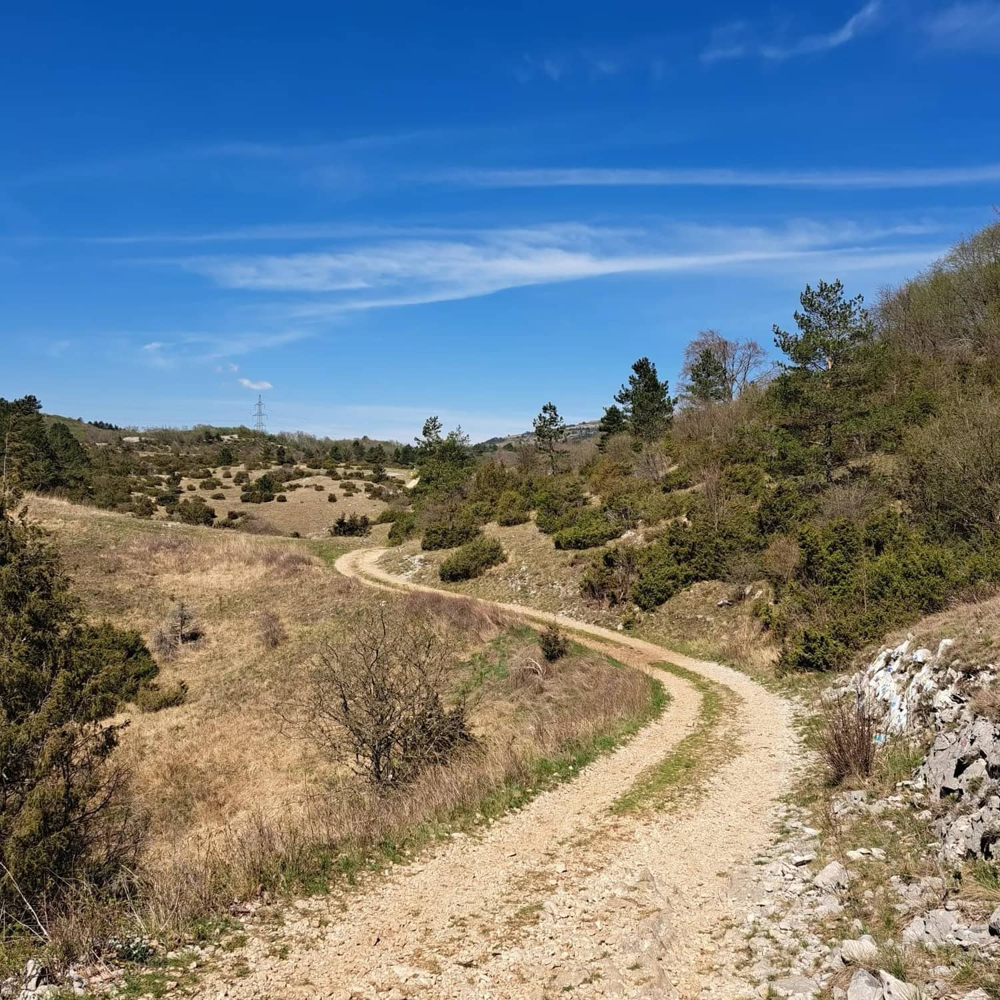
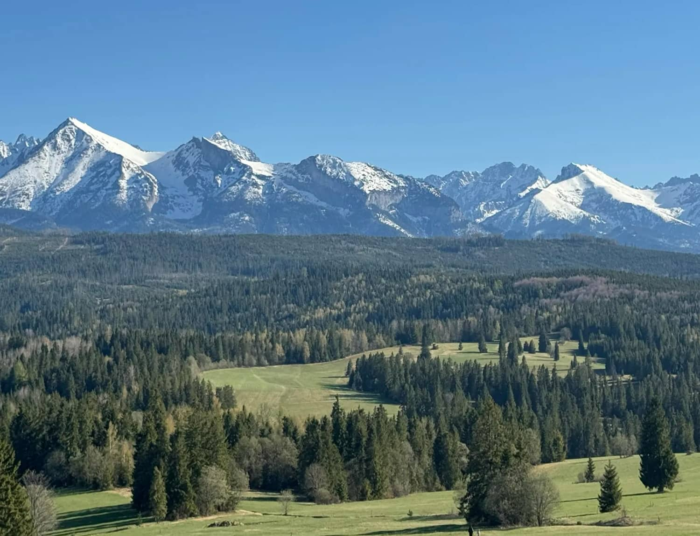
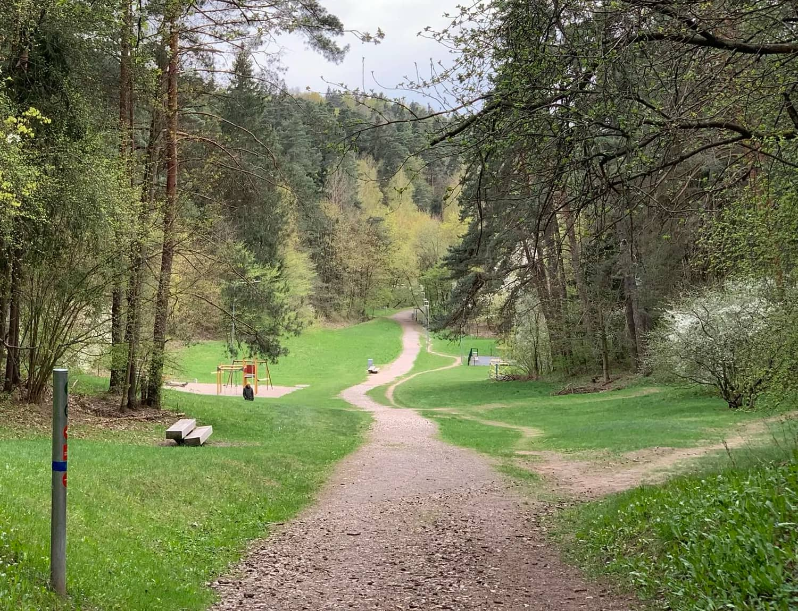
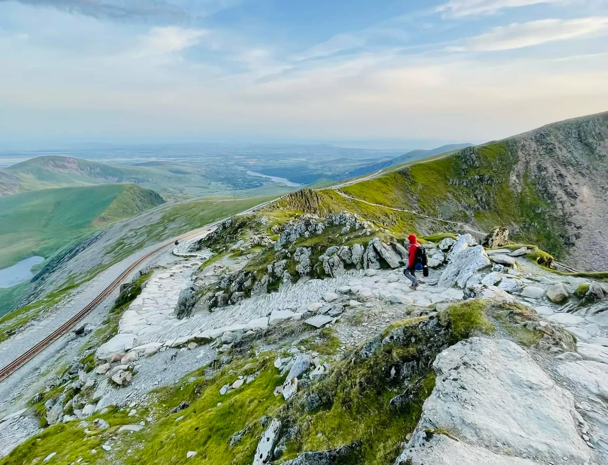
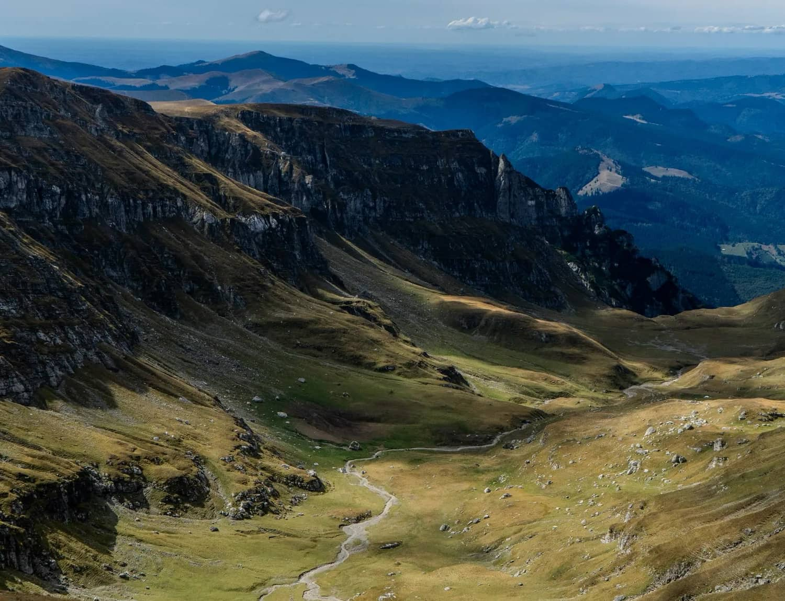
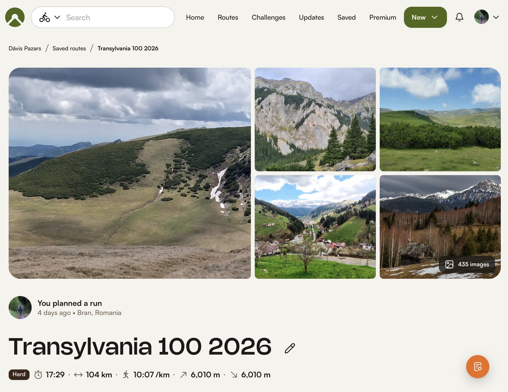
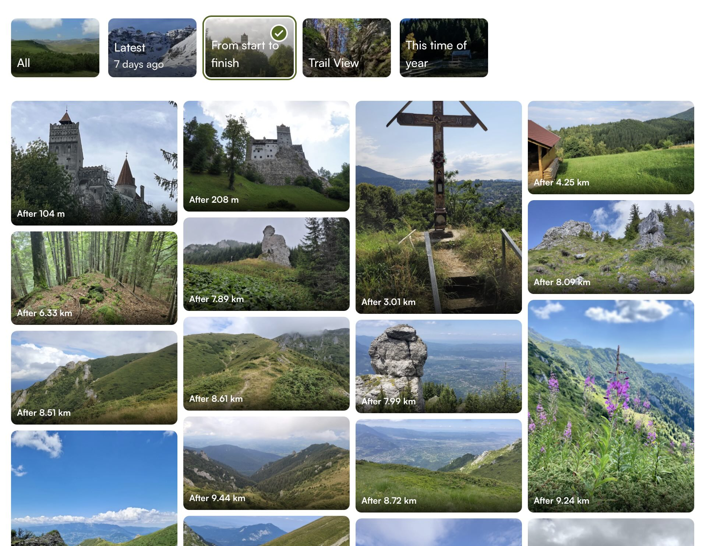

Vai tu nevēlies stundām ilgi sēdēt pie datora un izskatīt pieejamo sacensību mājaslapas? Vai tev beidzot izdevās atrast ko interesantu tikai, lai atklātu, ka reģistrācija ir noslēgusies? Ja tā, tad šis raksts ir priekš tevis. Esmu apkopojis 2027. gada pavasara sacensības, kas pievērsa manu uzmanību un kurām vēl joprojām var pieteikties. Beigās arī neliels padomiņš, kā pēc iespējas vieglāk gūt iespaidu par sacensību maršrutu dabā.

 

**2 - 4. Aprīlis, <a href="https://istria.utmb.world/" target="_blank" rel="noopener noreferrer">Istria by UTMB ↗</a>**, Istras pussalā Horvātijā.

Ieteiktu: Ziemā nosalušajiem un lēzenu, vieglāk skrienamu taku cienītājiem.

Lai gan bildes no maršruta nav gluži elpu aizraujošas, iespējams, sezonas pašā sākumā to nemaz nevajag. Viegli skrienami ceļi, temperatūra tuvu, bet visticamāk zem 20C un mērens reljefs daudziem varētu būt ideāli kāju iekustināšanai pēc ziemas. Patiesībā skriešanas ziņā liekas kaut kas līdzīgs Chianti by UTMB martā. Tikai šeit siltāks, bet tur dziļāka konkurence Western States kvalifikācijas dēļ. Nokļūšana diezgan vienkārša, ja esat gatavi nedaudz piemaksāt. Tas ir, lidot ar tiešo Airbaltic lidojumu uz Lļubļanu 1. aprīlī un uz dažām dienām iznomāt auto. Brauciens līdz starta vietai no Slovēnijas aptuveni 1.5h. Došanās nelielā kompānijā varētu amortizēt auto izmaksas. Ar sabiedrisko transportu nokļūšana varētu būt čakarīgi.

Ultru distances:
- 42 km / 1000 m+
- 70 km / 2400 m+
- 111 km / 4200 m+
- 168 km / 6800 m+

 
    
**16 - 18. aprīlis, <a href="https://www.sandnesultratrail.com/" target="_blank" rel="noopener noreferrer">Sandnes Ultra Trail ↗</a>**, Stavangeres apkaimē Norvēģijā.
 
Ieteiktu: Tiem, kurus nesatrauc sliktāki laikapstākļi, šarmē ziemeļu daba un tās miers.

Šīs sacensības varētu būt nedaudz metamais kauliņš. Ja nepaveicas, tu pēc garas ziemas tiec iemests tajā atpakaļ. Toties, ja paveicas, tu baudi unikālo Norvēģijas dabu skaistā pavasara dienā ārpus tūrisma sezonas. Miers un svaigs gaiss. Šeit ir arī iespējams kvalificēties uz Hardrock 100 skrējienu ASV, bet mērogs pasākumam izskatās reģionāls un diez vai būs daudz ārzemnieku. Lidojums ar pārsēšanos caur Oslo, nokļūšana tuvu starta vietai ar sabiedrisko. Nakšņot var kaut vai zem klajas debess. Bonuss šiem datumiem ir, ka 4 nedēļas iepriekš būs Lieldienu garās brīvdienas, attiecīgi iespēja aizvadīt kvalitatīvu pīķa apjoma treniņu nedēļu. Jā, 2027. gadā Lieldienas ir martā.

Ultru distances:
- 43 km / 2400 m+
- 80 km / 4550 m+
- 162 km / 8000 m+

")

 

**22 - 24. aprīlis, <a href="https://pieniny.utmb.world/" target="_blank" rel="noopener noreferrer">Pieniny by UTMB ↗</a>**, Polijas Pieniny kalnos netālu no Tatriem.

Ieteiktu: Kalnu pieredzes meklētājiem un jaunu trašu testētājiem.

Es ceru, ka neesmu vienīgais, kurš pirmajā reizē izlasīja Panini by UTMB. Latvietim Polija vienmēr būs vieni no vieglāk sasniedzamajiem kalniem un, ja dalība ar UTMB akmeņu iegūšanu iet labumā izlozēm uz fināliem, tad kāpēc gan ne? Interesanti, ka kopējais kāpums ir diezgan proporcionāls Latvijas paugurainākajiem skrējieniem (Vilkaču un Siguldas kalnu maratoni) un augstākie punkti nesniedzas stipri virs 1000 m. Tas nozīmē, ka kāpumi varētu būt garāki, bet ne masīvi un ne tādas stāvas sienas kā mājās. Manuprāt, izcils pieredzes pieturpunkts starp Latvijas un Alpu skrējieniem. Šis būs sacensību pirmais gads zem UTMB brenda. Kā tas izvērtīsies? To noskaidrot pirmajam arī ir sava veida azarts. Reģistrācija no 3. novembra (ar UTMB index) vai 5. novembra (bez UTMB index).

Ultru distances:
- 44 km / 2130 m+
- 65 km / 3260 m+
- 96 km / 4980 m+
- 137 km / 6115 m+

 

**1. maijs, <a href="https://www.vilniustrailrun.lt/" target="_blank" rel="noopener noreferrer">Vilnius Trail Run ↗</a>**, Viļņā, Lietuvā.

Ieteiktu: Jau tiecies pēc jau zināmā, tikai nedaudz citā iepakojumā.

Tāds kā pilsēttakas Stirnu Buks, tikai pie kaimiņiem. Styrnu Bukas? Viļņas apkaime ir gana pauguraina, tāpēc var rēķināties ar pie mums jau ierastajiem īsajiem, stāvajiem kalniņiem. Distanču piedāvājums plašs. Ir līdz 100 km, bet ir arī 4 km. Tādā ziņā ļoti _family friendly_. Izcila iespēja uz brīvdienām aizbraukt paskriet citā vidē bez papildu plānošanas čakara. Turp - atpakaļ kaut vai ar vilcienu. Bonusiņš, ka šīs ir arī UTMB index sacensības.

Ultru distances:
- 42 km / 1144 m+
- 70 km / 1667 m+
- 108 km / 2324 m+

 

**14 - 15. maijs, <a href="https://eryri.utmb.world/" target="_blank" rel="noopener noreferrer">Eryri by UTMB ↗</a>**, Velsā, Apvienotajā Karalistē.
 
Ieteiktu: Unikālu pieredžu kolekcionāriem un piedzīvojumu meklētājiem.

Agrāk šo sauca par Snowdonia by UTMB un jaunais nosaukums atgriežas pie reģiona vēsturiskā nosaukuma. Par dabu Velsā esmu dzirdējis tikai labu, un šis skrējiens noteikti ir manā bucket listā. Šis gan noteikti būs tehnisks skrējiens. To arī paši organizatori neslēpj. Ja tas nebiedē, tad piedzīvojums garantēts. Viena no distancēm (78 km) ir relatīvi plakana, bet visādi citādi kopējie kāpumi diezgan brangi. Tas tā, ja nu kādam 100 jūdzes ir par maz un prasās vēl paķert pa ceļam Everesta apjomu ar kāpumu.

Ultru distances:
- 56 km / 3400 m+
- 78 km / 2500 m+
- 108 km / 5800 m+
- 163 km / 9200 m+

 
    
**29. maijs, <a href="https://www.transylvania100k.com/" target="_blank" rel="noopener noreferrer">Transylvania 100 ↗</a>**, Branā, Rumānijā.

Ieteiktu: Unikālu pieredžu kolekcionāriem un piedzīvojumu meklētājiem #2.

Branā ir iespaidīga pils, ko reklamā kā Drakulas pili, lai gan saikne ar Brema Stokera romānu īsti nav apliecināta. Turpretim fakts, ka šīs sacensības izskatās diezgan episkas un norisinās vienā no Eiropā neskartākajiem dabas reģioniem Transilvānija ir diezgan patiess. Nokļūšana ir salīdzinoši vienkārša un izdevīga. Šobrīd tiešais lidojums turp-atpakaļ uz Bukaresti ir zem 200 eiro, dalība ap 100 un izmaksas uz vietas drošvien zemākas kā mājās. Jo vairāk es uz šīm sacensībām skatos, jo vairāk tās mani pašu ieintriģē. Vienīgi jāņem vērā, ka sacensības ir reljefainas un sacensību augstākais punkts ap 2500 m vjl. maija beigās vēl varētu būt ar Noskrien Ziemu elementiem.

Ultru distances:
- 50 km / 3320 m+
- 80 km / 4910 m+
- 100 km / 6444 m+

Iespējams, jau manīji, ka pie gandrīz katrām sacensībām bija trases foto no Komoot. Es nezinu, kāpēc tā, bet lielākā daļa sacensību organizatoru ir skopi ar skatiem no trases. Ja ir galerijas, tad tās pārsvarā ir ar dalībniekiem, starta un finiša zonām vai arī tikai pašiem iespaidīgākajiem skatiem dažās vietās. Kad es meklēju sacensības, man patiesībā visvairāk interesē, kāds būs visparastākais kilometrs un kāds kopumā ir vaibs trasei. Par laimi Komoot, augšupielādējot trases GPX, uzreiz piedāvās galeriju ar bildēm no trases. Atliek tikai atrast pašu GPX. Sacensību iepriekšēji gadi praktiski vienmēr ir kaut kur pieejami. Ja nav, tad apkaimes attēlus var arī vienkārši apskatīties kartē.

Attēlus var arī organizēt, piemēram, hronoloģiski, no starta līdz finišam. Tos Komoot platformā var pievienot ikviens, tāpēc nav slēpta motivācija parādīt tikai labāko. Var gadīties, ka bilžu ir maz vai nav vispār, bet tādos populāros un apdzīvotos reģionos kā Alpi to drīzāk ir par daudz.
    

 
